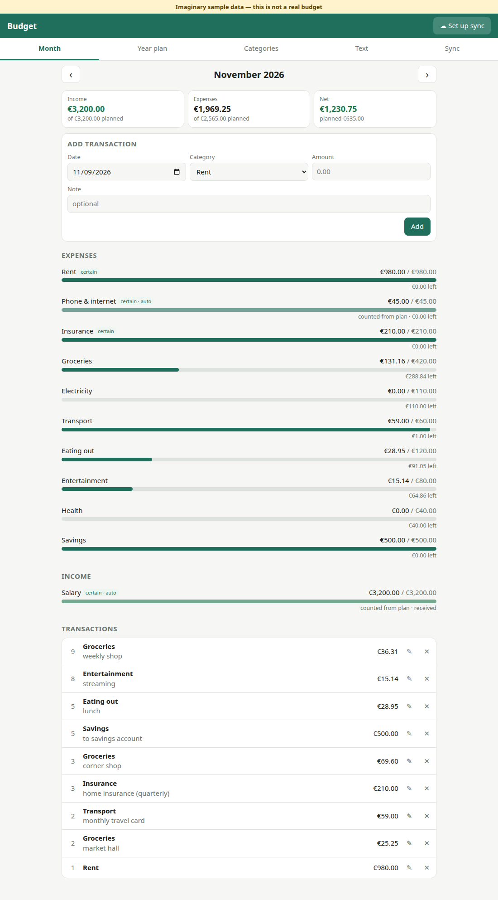
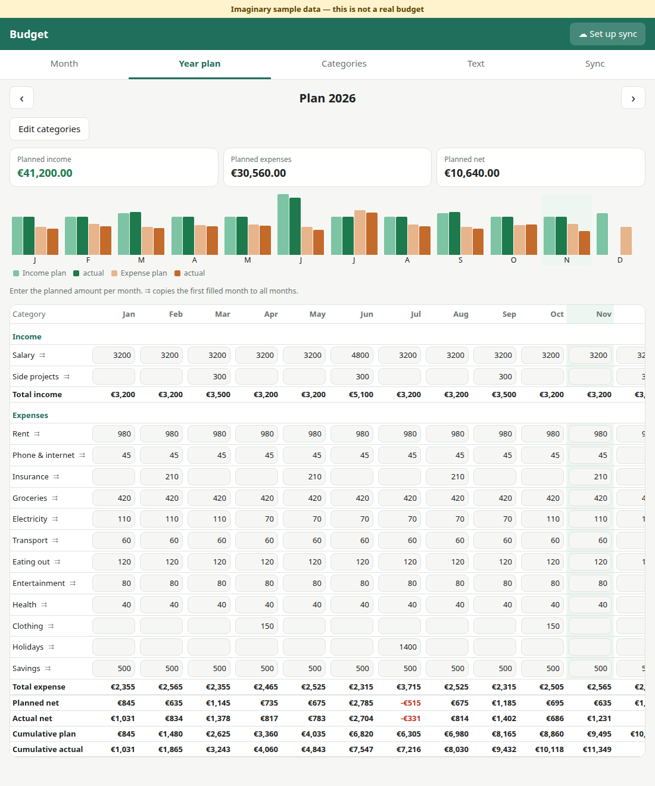
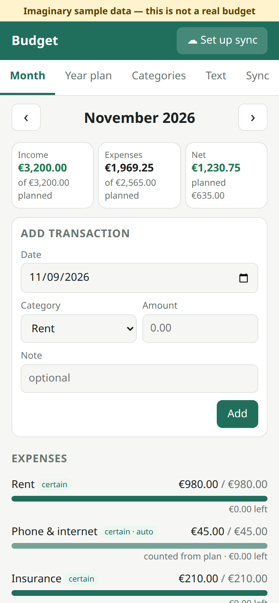
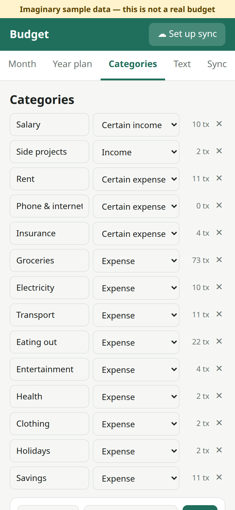
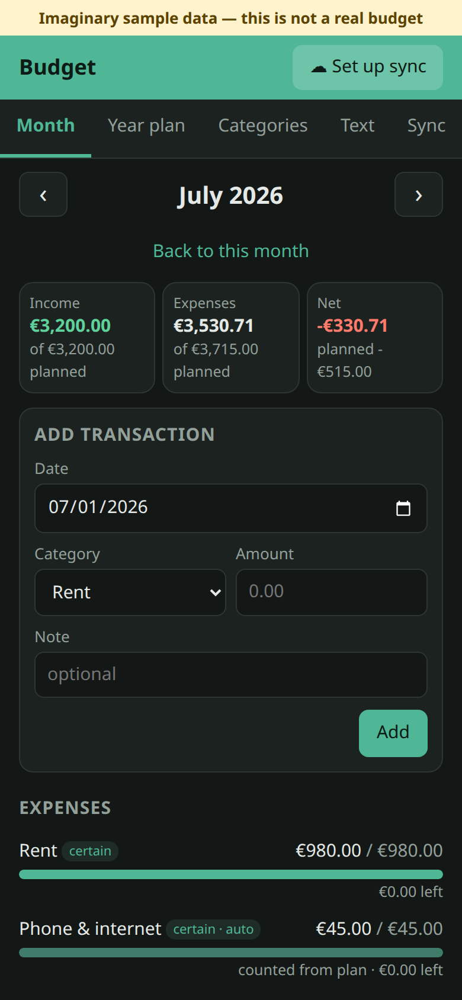

# Budget

A small budgeting app that tracks your money month by month and lets you plan income and expenses for the whole year.
It is an installable web app (PWA), so the same code runs on **Ubuntu** (in the browser, or installed as an app from Chrome/Chromium) and on **Android** (installed to the home screen from Chrome).
It also works offline. The interface is available in **Finnish and English**: choose the language from the menu in the top bar.

All data is one **plain-text file**, `budget.txt`. You can sync it through **Google Drive**.

## Screenshots

> **Note:** these screenshots show an **imaginary sample budget** ([`examples/budget.txt`](examples/budget.txt)).
> All names, amounts and transactions in it are made up. It is not anyone's real finances.

| Month (desktop) | Year plan |
|---|---|
|  |  |

| Month (phone) | Categories (phone) | Dark mode, July (phone) |
|---|---|---|
|  |  |  |

To try the sample yourself, paste `examples/budget.txt` into the **Text** tab and press Apply.
Do this on a test device or browser profile, because it replaces your data there.

## Features

- **Month**: add, edit and delete transactions. See actual vs. planned spending per category, with progress bars and over-budget warnings.
- **Year plan**: a grid of categories × 12 months. Use ⇉ to fill a row, or copy last year's plan. It shows planned and actual net per month, cumulative totals, and a chart.
- **Categories**: add, rename (updates all transactions and plans), delete (only when unused: the `N x` count shows how many plan and transaction lines mention it), and set the type: income, expense, *certain income* or *certain expense*. Certain categories count their planned amount without needing a transaction. You can also set the currency here.
- **Text**: view and edit the raw file directly. Parse errors are shown with line numbers.
- **Learn / Opi**: a light training mode in English and Finnish. Eight short lessons teach how to budget and why: you *know in advance whether problems are coming*, it gives you *more control over your life*, and *money becomes a resource*. "Try it" jumps to the right place in the app, and progress is ticked automatically when your budget shows the step is done. A fresh install shows a small invitation to start the lessons.
- **Sync**: Google Drive sync with automatic 3-way merge, so edits from your phone and laptop are combined. You can also download or import the file.

## File format

```
currency EUR

category Salary income
category "Car insurance" expense
category Groceries expense
category Rent expense certain      # counts automatically, see below

plan 2026 Salary 3500 all          # every month
plan 2026 Salary 4000 7            # July differs
plan 2026 "Car insurance" 640 3,9  # March and September
plan 2026 Groceries 450 1-12

2026-11-03 Groceries 54.20 Lidl    # DATE CATEGORY AMOUNT [note]
2026-11-05 Groceries -12 refund    # negative = refund
```

- `certain` marks income or expenses that will definitely happen, such as salary or rent. In a month with no transactions for that category, its planned amount counts as actual. Once you enter a transaction, the real amount is used instead.
- Lines starting with `#` are comments.
- Names containing spaces must be in quotes.
- Decimal comma (`54,20`) is accepted.
- The app rewrites the file in a canonical, sorted form when you edit through the UI, so hand-written comments are not kept.

## Running it

It's static files, no build step.

**On Ubuntu, locally:**

```sh
cd ~/budgeting
python3 -m http.server 8000     # or: npm start
```

Then open <http://localhost:8000>. In Chrome/Chromium you can install it as an app with the install icon in the address bar.

**On Android**, the app needs an HTTPS address. The easiest free option is GitHub Pages:

1. Push this folder to a GitHub repo.
2. In the repo, go to *Settings → Pages* and deploy from the `main` branch, root folder.
3. Open `https://<you>.github.io/<repo>/` in Chrome on Android and choose *⋮ → Add to Home screen / Install app*.

Netlify, Cloudflare Pages or any static host works too. Your data is never sent to the host: it stays on the device and in your Google Drive.

## Google Drive sync setup (one-time, about 5 minutes)

1. Go to <https://console.cloud.google.com/>, create a project (e.g. "Budget").
2. *APIs & Services → Library*: enable **Google Drive API**.
3. *APIs & Services → OAuth consent screen*: choose **External** and fill in the app name and your email.
   Under *Test users*, add your own Google account. You can leave the app in "Testing" mode.
4. *APIs & Services → Credentials → Create credentials → OAuth client ID*:
   - Application type: **Web application**
   - Authorized JavaScript origins: `http://localhost:8000` and your hosted origin, e.g. `https://<you>.github.io`
5. Copy the client ID (`….apps.googleusercontent.com`) into the app's **Sync** tab on each device, then press **Sync now**.

How the sync works:

- The app uses the minimal `drive.file` permission. It can only see files it created itself: one `budget.txt` in the root of your Drive.
- On the first sync, the app creates that file, or merges with it if another device already created it.
- After that, changes sync automatically about 2 seconds after each edit, and again when the app comes back to the foreground, as long as the Google sign-in is still valid. A sign-in lasts about 1 hour. After that, tap **Sync** in the header to sign in again.
- If both devices changed the file, the changes are merged line by line. Additions and deletions from both sides are kept. If both sides changed the same plan cell, the result may keep either value, so check the Year plan after a merge.
- In testing mode, Google may ask you to re-approve the app about once a week.

## Project layout

| File | Purpose |
|---|---|
| `index.html`, `style.css` | Shell and styling (light/dark) |
| `app.js` | UI, local storage, sync orchestration |
| `core.js` | Text format parser/serializer, merge, statistics (no DOM) |
| `drive.js` | Google sign-in and Drive REST calls |
| `i18n.js` | All UI text in Finnish and English |
| `learn.js` | Training-mode lessons (fi/en) and progress checks (no DOM) |
| `sw.js`, `manifest.webmanifest`, `icon*` | Offline support and installability |
| `test/core.test.mjs` | Unit tests: `npm test` |
